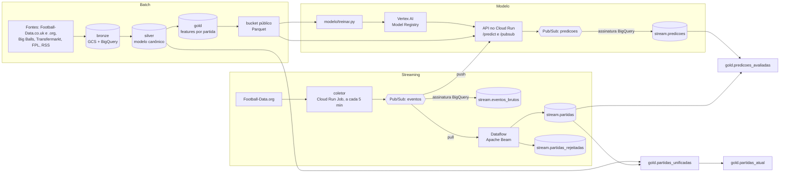

# Foota Toota

Plataforma de informações para fãs de futebol. Reúne partidas, estatísticas,
odds, notícias, transferências e valores de mercado de 12 ligas desde 2003,
organiza tudo em camadas medalhão no BigQuery, acompanha o Brasileirão em
tempo real e prevê o resultado de cada partida com um modelo servido por uma
API REST no Cloud Run.

[![CI][ci-badge]][ci]
[![Python][python-badge]][python]
[![License: MIT][license-badge]][license]
[![uv][uv-badge]][uv]
[![Ruff][ruff-badge]][ruff]
[![pre-commit][pre-commit-badge]][pre-commit]

**API do modelo em produção:** <https://modelo-api-3gvoh2dyuq-uc.a.run.app>
([como chamar](#api-do-modelo))

## Arquitetura

Dois caminhos de dados se encontram no BigQuery. O **batch** reconstrói o
histórico de todas as fontes nas camadas bronze, silver e gold. O
**streaming** traz cada mudança de partida do Brasileirão poucos minutos
depois de ela acontecer. O modelo é treinado sobre a gold do batch e responde
tanto a chamadas HTTP quanto aos eventos do stream.



### Batch

1. **Bronze.** Os scripts de `scripts/` baixam cada fonte para `data/bronze/`
   e sobem os arquivos para `gs://GCS_BUCKET/bronze/`. Em `sql/01_bronze`,
   cada fonte vira uma tabela externa sobre o bucket e uma tabela nativa.
2. **Silver.** `sql/02_silver` monta o modelo canônico: partidas, clubes,
   jogadores, odds, estatísticas, classificação, notícias, transferências.
   Os ids de clube das várias fontes são unificados: `silver.team_map` liga
   os ids casando jogos por liga, data e placar. As regras de
   `sql/03_silver_checks` são `ASSERT` bloqueantes; linhas com problema vão
   para a quarentena `quality.occurrences`.
3. **Gold.** `sql/04_gold` calcula os atributos de cada partida (forma nos
   últimos 5 jogos, média de pontos na temporada, dias de descanso, confronto
   direto) usando só jogos anteriores ao início dela, e separa as partidas em
   `TRAIN`, `EVAL`, `TEST` e `PREDICT`. `sql/05_gold_checks` prova que não há
   vazamento temporal.
4. **Exportação.** Silver e gold vão em Parquet para o bucket público, de
   onde a API do modelo e a plataforma leem sem precisar de conta no GCP.

`scripts/atualizar_partidas.sh` refaz esse caminho para as fontes de
partidas. Um Cloud Run Job diário coleta as notícias.

### Streaming

O coletor (`streaming/producer.py live`) roda como Cloud Run Job a cada 5
minutos: consulta o Brasileirão no Football-Data.org e publica no tópico
`eventos` só as partidas que mudaram (status, placar ou horário). Cada evento
é um JSON com um `event_id` que identifica aquela versão da partida. O modo
`replay` reproduz rodadas já jogadas, para demonstrar o fluxo a qualquer
hora.

Três assinaturas consomem o tópico:

| Assinatura | Tipo | Destino |
| --- | --- | --- |
| `eventos-bigquery` | BigQuery | `stream.eventos_brutos`: cada mensagem como chegou, o bronze do stream |
| `eventos-dataflow` | Pull | Dataflow: valida, limpa e grava em `stream.partidas`; o que for recusado vai para `stream.partidas_rejeitadas` com o motivo |
| `eventos-api` | Push | `POST /pubsub` da API do modelo, que prevê as partidas agendadas |

O pipeline do Dataflow (`streaming/pipeline.py`) recusa eventos sem campos
obrigatórios, com competição ou status desconhecido, com mandante igual ao
visitante, com placar negativo ou partida encerrada sem placar. Os ids de
liga e o status saem no mesmo formato da silver.

No BigQuery, três views juntam o histórico do batch com o stream:

| View | O que mostra |
| --- | --- |
| `gold.partidas_unificadas` | Partidas da silver (`origem = 'batch'`) e o último estado de cada partida do stream (`origem = 'stream'`), com os mesmos ids de clube |
| `gold.partidas_atual` | O estado mais recente de cada partida entre batch e stream ao vivo: o que a plataforma lê |
| `gold.predicoes_avaliadas` | Cada predição ao lado do resultado real, quando a partida termina, e se o modelo acertou |

### Modelo

`modelo/treinar.py` treina um modelo por liga (Brasileirão e Premier League),
um `HistGradientBoostingClassifier` do scikit-learn sobre a gold pública:
escolhe os hiperparâmetros pela log loss em `EVAL`, retreina em
`TRAIN + EVAL` e mede em `TEST`. Uma versão nova só é promovida se, em
`TEST`, bater o "sempre mandante" em acurácia, as frequências do treino em log
loss e o modelo em produção. A versão aprovada é registrada no Vertex AI
Model Registry com o alias `campeao`, e cada execução, aprovada ou não, vira
um run no Vertex AI Experiments.

A API (`modelo/api.py`, FastAPI) carrega a versão `campeao` de cada liga e
confere a cada 10 minutos se ela mudou, então trocar o modelo não exige novo
deploy. As predições são publicadas no tópico `predicoes`, que uma
assinatura BigQuery grava em `stream.predicoes`.

### Escolhas técnicas

- **Particionamento por dia.** As tabelas do stream são particionadas pela
  data de publicação do evento, de processamento ou da predição: o stream só
  escreve na partição do dia, e as consultas por período leem só as partições
  do intervalo. `silver.matches` é particionada pela data do jogo.
- **Clusterização pela chave de leitura.** `stream.partidas` é clusterizada
  por liga e partida, `stream.predicoes` por partida e `silver.matches` por
  liga e clubes: a página de um jogo lê poucos blocos.
- **Bronze do stream sem código.** A assinatura BigQuery grava toda mensagem
  mesmo com o Dataflow desligado, e a assinatura do Dataflow guarda os eventos
  por 7 dias. Ao religar o job, ele processa o acumulado sem perder nada.
- **Quarentena em vez de descarte.** Eventos inválidos, e linhas que o próprio
  BigQuery recusa, vão para `stream.partidas_rejeitadas` com o motivo e a
  mensagem original.
- **Reentrega sem duplicar.** O Pub/Sub entrega pelo menos uma vez. O
  `event_id` identifica a versão da partida, e o `prediction_id` é o mesmo
  para o mesmo evento e a mesma versão do modelo.
- **Cache velho da fonte.** A API do Football-Data.org às vezes devolve por
  alguns minutos uma rodada já jogada como agendada. As views dão preferência
  à versão encerrada de cada partida, mesmo que chegue uma mais nova.
- **Serverless e barato.** O coletor é um job que roda e termina, não um
  serviço sempre ligado; a API escala a zero. Só o Dataflow cobra por hora, e
  por isso ele pode ser desligado sem perda de dados.

## Requisitos

- Python 3.12 ou superior
- [uv](https://docs.astral.sh/uv/) para gerenciar o ambiente
- O [Google Cloud SDK][gcloud] (`gcloud` e `bq`) autenticado em um projeto
  com BigQuery, Cloud Storage, Pub/Sub, Dataflow, Cloud Run e Vertex AI
- Uma chave gratuita do [Football-Data.org][fdorg]
- Uma chave da Big Balls Data, gratuita em [bigballsdata.com][keys], para o
  cliente da API e a captura da Premier League

## Instalação

```bash
make install
cp .env.template .env
```

Preencha o `.env`:

| Variável | Para quê |
| --- | --- |
| `GCP_PROJECT_ID` | Projeto do BigQuery, Pub/Sub, Dataflow e do coletor |
| `GCS_BUCKET` | Bucket do bronze e das tabelas públicas |
| `FOOTBALLDATA_API_KEY` | Chave do Football-Data.org, usada pelo batch e pelo coletor |
| `BIGBALLSDATA_API_KEY` | Chave da Big Balls Data |
| `MODELO_PROJECT_ID` | Projeto dos modelos e da API; sem ela, vale `GCP_PROJECT_ID` |
| `MODELOS_BUCKET` | Bucket dos artefatos dos modelos |

No Windows com Git Bash, troque `BQ_BIN=bq` por `BQ_BIN=bq.cmd`. O `.env`
está ignorado pelo Git. Nunca versione uma chave real.

## Como executar

### Executar o batch

```bash
gcloud auth login
uv run python scripts/fetch_bronze.py                 # Football-Data.co.uk e .org, Brasileirão, RSS
uv run python scripts/fetch_transfers_and_fantasy.py  # Transfermarkt, FPL, classificação
cd sql
./ingest.sh                   # captura da Big Balls (data/epl) -> gs://GCS_BUCKET
./run.sh [0-9]*               # bronze -> silver -> gold, com as regras de qualidade
cd ..
scripts/exportar_tabelas_publicas.sh                  # silver e gold -> bucket público
```

`sql/run.sh` executa cada `.sql` na ordem das pastas, um statement por
arquivo, trocando `PROJECT` e `BUCKET` pelos valores do `.env`. Aceita pastas
ou arquivos: `./run.sh 04_gold 05_gold_checks` refaz só a gold. Uma regra que
falha (`ASSERT`) para a execução ali, e a saída de cada script fica em
`sql/out/`. `./run.sh healthcheck.sql` confere em segundos, sem alterar
nada, se o pipeline está de pé.

Para manter as partidas em dia, `scripts/atualizar_partidas.sh` coleta de
novo o Football-Data.org e o Football-Data.co.uk, reconstrói o bronze dessas
fontes, a silver e a gold, e reexporta as tabelas públicas.

| Pasta | O que cria |
| --- | --- |
| `00_setup` | Datasets `bronze`, `silver`, `gold`, `quality`; UDF `blank_to_null`; apelidos de clubes. |
| `01_bronze` | Tabelas externas e nativas de cada fonte. |
| `02_silver` | Modelo canônico: `matches`, `teams`, `team_map`, `players`, `stats`, `odds`, `standings`, `news`, `transfers`... |
| `03_silver_checks` | Regras S1 a S23 como `ASSERT` bloqueantes; quarentenas em `quality.occurrences`. |
| `04_gold` | `match_features` e as tabelas de features e treino por liga. |
| `05_gold_checks` | Regras G1 a G8, incluindo a prova de zero vazamento temporal. |
| `06_model` a `08_prediction` | Modelos de referência em BigQuery ML, avaliação e previsões. |
| `09_report` | View `quality.report`. |
| `10_stream` | Dataset `stream`, tabelas do streaming e views que juntam batch e stream. |

### Executar o streaming

```bash
streaming/infra.sh               # tópicos, assinaturas, dataset stream e views
streaming/deploy_coletor.sh      # coletor no Cloud Run Job + Cloud Scheduler (5 min)
streaming/dataflow.sh iniciar    # pipeline no Dataflow (cobra por hora)
streaming/dataflow.sh status
streaming/dataflow.sh parar      # drena e encerra
```

Para ver o fluxo sem esperar uma rodada, reproduza rodadas já jogadas:

```bash
uv run python streaming/producer.py replay --rodadas 28-30 --intervalo 1
uv run python streaming/producer.py --sem-publicar replay --rodadas 30 --intervalo 0  # só mostra
```

E acompanhe no BigQuery o batch e o stream lado a lado:

```sql
SELECT origem, mode, COUNT(*) FROM gold.partidas_unificadas GROUP BY 1, 2;

SELECT model_version, AVG(IF(hit, 1, 0)) AS acerto, COUNT(hit) AS partidas
FROM gold.predicoes_avaliadas
WHERE hit IS NOT NULL
GROUP BY 1;
```

### Treinar e publicar o modelo

```bash
# treina, avalia e registra no Vertex AI
uv run --no-project --with-requirements modelo/requirements-treino.txt \
    python modelo/treinar.py

# build da imagem (modelo/Dockerfile) e deploy no Cloud Run
modelo/deploy_api.sh

# liga a API ao stream: push dos eventos e permissão de publicar predições
EVENTOS_PUSH_URL=<url da API>/pubsub MODELO_SA=<conta de serviço da API> \
    streaming/infra.sh
```

O `deploy_api.sh` imprime no fim a URL do `/pubsub` e a conta de serviço que
vão no último comando.

### API do modelo

| Rota | O que faz |
| --- | --- |
| `POST /predict` | Recebe o `match_id` de uma partida (ou as features, para simular) e devolve as probabilidades de vitória do mandante, empate e vitória do visitante |
| `POST /pubsub` | Recebe o push da assinatura `eventos-api`, prevê as partidas agendadas e publica em `predicoes` |
| `GET /health` | Versão do modelo e partidas carregadas de cada liga |

```bash
curl -s https://modelo-api-3gvoh2dyuq-uc.a.run.app/health

curl -s -X POST https://modelo-api-3gvoh2dyuq-uc.a.run.app/predict \
  -H 'Content-Type: application/json' \
  -d '{"match_id": "fdorg_555052"}'
```

```json
{
  "prediction_id": "0836e337-f90e-4482-8d09-787fb92e8a1c",
  "event_id": null,
  "match_id": "fdorg_555052",
  "league_id": "brasileirao_serie_a",
  "model_name": "boosted_tree_brasileirao",
  "model_version": "1",
  "prob_home": 0.6325,
  "prob_draw": 0.1909,
  "prob_away": 0.1766,
  "predicted_outcome": "home",
  "predicted_at": "2026-10-26T18:46:54Z"
}
```

Para simular uma partida, envie as features e `"publicar": false`, que não
publica a predição no tópico:

```bash
curl -s -X POST https://modelo-api-3gvoh2dyuq-uc.a.run.app/predict \
  -H 'Content-Type: application/json' \
  -d '{"match_id": "simulada", "league_id": "brasileirao_serie_a", "publicar": false,
       "features": {"home_avg_points_season": 2.3, "away_avg_points_season": 0.8,
                    "diff_avg_points_season": 1.5}}'
```

O serviço escala a zero: a primeira chamada depois de um tempo parado leva
cerca de 25 segundos, porque carrega a gold e os modelos; as seguintes
respondem em menos de meio segundo. Formatos das mensagens, tabelas e permissões estão
em [docs/arquitetura/contratos.md](docs/arquitetura/contratos.md), e um
roteiro de demonstração em
[docs/arquitetura/demo-modelo.md](docs/arquitetura/demo-modelo.md).

### Cliente da API Big Balls

```python
from footatoota import AppConfig, configure_logging, create_client

configure_logging(AppConfig())

with create_client() as client:
    table = client.standings.get(league="epl")[0]
    for row in table.top(5):
        print(row.rank, row.team_name, row.league_points)
```

`create_async_client` devolve o equivalente assíncrono. Para inspecionar de
onde veio cada opção antes de conectar, use `load_settings().explain()`.

O comando `footatoota` verifica a configuração e a conexão, imprimindo a
procedência de cada opção, o plano da conta e a saúde do serviço:

```bash
uv run footatoota
```

O que não é segredo é versionado em `config/bigballsdata.toml`. As chaves de
topo configuram o cliente HTTP ([pitchside][pitchside]), e a tabela
`[footatoota]` configura a aplicação. A precedência é: argumento explícito,
depois variável de ambiente, depois o arquivo, depois os padrões. As chaves
do cliente aceitam o prefixo `PITCHSIDE_` e as da aplicação o prefixo
`FOOTATOOTA_`.

## Estrutura

| Caminho | Conteúdo |
| --- | --- |
| `scripts/` | Coleta do batch, atualização das partidas e exportação pública |
| `sql/` | Camadas bronze, silver e gold, regras de qualidade e tabelas do stream |
| `streaming/` | Coletor, pipeline Apache Beam, infraestrutura e deploy |
| `modelo/` | API, treino, Dockerfile, SQL de avaliação e deploy no Cloud Run |
| `src/footatoota/` | Configuração do cliente da Big Balls Data |
| `tests/` | Testes do cliente, do streaming e do modelo |
| `docs/` | Contratos do pipeline, camada silver e [catálogo de 129 fontes de futebol](docs/fontes-futebol/README.md) |
| `Dockerfile` | Imagem do job diário de notícias |

## Desenvolvimento

| Comando | O que faz |
| --- | --- |
| `make install` | Sincroniza dependências e instala os hooks. |
| `make format` | Aplica `ruff check --fix` e `ruff format`. |
| `make lint` | Verifica lint e formatação. |
| `make typecheck` | Roda o `ty`. |
| `make test` | Roda a suíte, sem os testes marcados `live`. |
| `make test-cov` | Roda a suíte com cobertura. |
| `make check` | Lint, tipos e testes, o mesmo que a CI. |
| `make clean` | Esvazia o cache em disco do cliente. |

As respostas HTTP nos testes são simuladas com `respx`. Um teste marcado
com `@pytest.mark.live` só roda com `uv run pytest -m live` e exige uma
chave válida.

## Licença

MIT. Ver [LICENSE](LICENSE).

[ci]: https://github.com/phael-exe/foota-toota/actions/workflows/ci.yml
[ci-badge]: https://github.com/phael-exe/foota-toota/actions/workflows/ci.yml/badge.svg
[fdorg]: https://www.football-data.org/client/register
[gcloud]: https://cloud.google.com/sdk/docs/install
[keys]: https://bigballsdata.com/dashboard/keys
[license]: LICENSE
[license-badge]: https://img.shields.io/badge/license-MIT-green.svg
[pitchside]: https://pypi.org/project/pitchside/
[pre-commit]: https://github.com/pre-commit/pre-commit
[pre-commit-badge]: https://img.shields.io/badge/pre--commit-enabled-brightgreen?logo=pre-commit&logoColor=white
[python]: https://www.python.org/downloads/
[python-badge]: https://img.shields.io/badge/python-3.12+-blue.svg
[ruff]: https://github.com/astral-sh/ruff
[ruff-badge]: https://img.shields.io/endpoint?url=https://raw.githubusercontent.com/astral-sh/ruff/main/assets/badge/v2.json
[uv]: https://github.com/astral-sh/uv
[uv-badge]: https://img.shields.io/endpoint?url=https://raw.githubusercontent.com/astral-sh/uv/main/assets/badge/v0.json
